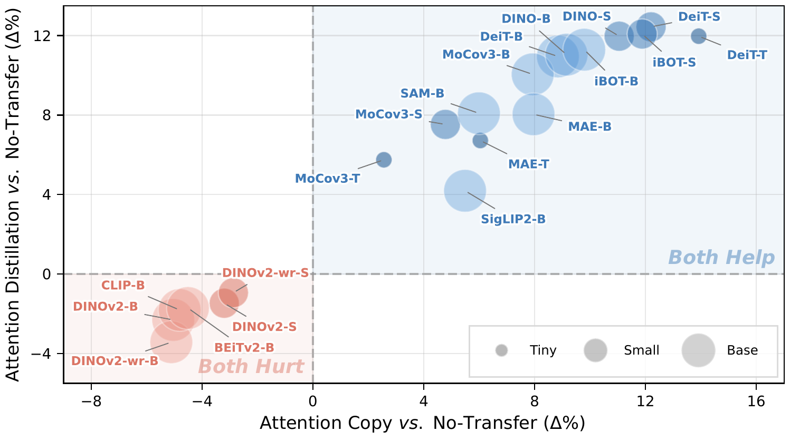

<div align="center">

# Attention Transfer Is Not Universally Effective for Vision Transformers

### NeurIPS 2026

Huaiyuan Qin<sup>1</sup>&nbsp;&nbsp; Muli Yang<sup>1</sup>&nbsp;&nbsp; Gabriel James Goenawan<sup>1</sup>&nbsp;&nbsp; Peng Hu<sup>2</sup>&nbsp;&nbsp; Chen Gong<sup>3</sup>&nbsp;&nbsp; Xi Peng<sup>2</sup>&nbsp;&nbsp; Hongyuan Zhu<sup>1</sup>

<sup>1</sup>Institute of Advanced Intelligence and Computing (IAIC), A*STAR&nbsp;&nbsp;&nbsp;
<sup>2</sup>Sichuan University&nbsp;&nbsp;&nbsp;
<sup>3</sup>Shanghai Jiao Tong University

[](https://arxiv.org/abs/2605.07191)
[](https://arxiv.org/pdf/2605.07191)
[](https://leonqin430.github.io/projects/attention-transfer-universally/)
[](LICENSE)



**Attention is sufficient *only* when the student architecture matches the teacher.**

</div>

Attention Transfer (Li et al., NeurIPS 2024) trains a randomly initialized student ViT that receives only the
attention patterns of a pre-trained teacher. We revisit it on 20 teachers from 11 ViT families and find that
4 families (DINOv2, DINOv2-wr, CLIP, BEiTv2) consistently fail under the standard student architecture.
The failure is caused by an architectural mismatch between teacher and student: adding the teacher's native
components (`LayerScale`, `PreLayerNorm`, `RelativePositionBias`) to the student in a randomly initialized
state reverses the failure for all 4 families.

This repository is a minimal fork of the
[PyTorch implementation of Attention Transfer](https://github.com/alexlioralexli/attention-transfer)
(itself based on [MAE](https://github.com/facebookresearch/mae)). It contains the training code for

* the **No-Transfer** baseline (a student trained from scratch),
* **Attention Copy** and **Attention Distillation** with the standard teacher-student architecture, and
* the **native-architecture rescue**: the same transfer with a student that carries the teacher's native components.

## Installation

```bash
conda env create -f environment.yml
conda activate attn-transfer
```

Tested with Python 3.12, PyTorch 2.9 and timm 0.4.12 (the timm version used by the original code).

## Data

ImageNet-1K in the standard `ImageFolder` layout:

```
/path/to/imagenet/train/<class>/*.JPEG
/path/to/imagenet/val/<class>/*.JPEG
```

## Teacher checkpoints

`--finetune` takes a checkpoint whose state dict (or whose `model` entry) uses the key names of this
code base, i.e. DeiT / MAE-style keys with a 16x16 patch embedding and a 224x224 input
(`pos_embed` of shape `(1, 197, D)`):

| component | keys |
|---|---|
| standard ViT | `cls_token`, `pos_embed`, `patch_embed.proj.{weight,bias}`, `blocks.{i}.norm1.*`, `blocks.{i}.attn.qkv.*`, `blocks.{i}.attn.proj.*`, `blocks.{i}.norm2.*`, `blocks.{i}.mlp.fc1.*`, `blocks.{i}.mlp.fc2.*`, `norm.*` |
| LayerScale (DINOv2, DINOv2-wr, BEiTv2) | `blocks.{i}.gamma1`, `blocks.{i}.gamma2` |
| pre-LayerNorm (CLIP) | `ln_pre.{weight,bias}` |
| relative position bias (BEiTv2) | `blocks.{i}.attn.relative_position_bias_table` |

The checkpoint is loaded with `strict=False`: keys that do not exist in the chosen architecture are ignored.
A standard-architecture teacher (`dual_vit_*_patch16`) therefore uses none of the native components even
if the checkpoint contains them, while a native-architecture teacher (`dual_vit_dinov2_*`, `dual_vit_clip_*`,
`dual_vit_beitv2_*`) loads them. Official checkpoints of the 11 families need a one-off conversion to this
layout (DeiT, DINO, MoCo v3, MAE and iBOT already use it up to a key prefix; DINOv2 needs its patch
embedding and position embedding interpolated from patch 14 to patch 16 and `ls{1,2}.gamma` renamed to
`gamma{1,2}`; CLIP, SigLIP2, SAM and BEiTv2 need their attention and MLP weights renamed and, where split,
concatenated into `qkv`).

## Training

All commands use a single machine with 8 GPUs and a total batch size of 1024 (`--batch_size` is per GPU).
The recipes below are the ones of the paper (training-recipe table in the appendix): 20 epochs, AdamW, cosine schedule
with 5 warm-up epochs, RandAugment, label smoothing 0.1, Mixup 0.8, CutMix 1.0, EMA 0.9999, 3 seeds.

**No-Transfer baseline** (`scripts/no_transfer.sh`)

```bash
torchrun --nproc_per_node=8 main_finetune.py \
    --model vit_small_patch16 \
    --epochs 20 --warmup_epochs 5 --batch_size 128 \
    --blr 1e-3 --layer_decay 0.75 --beta2 0.999 --weight_decay 0.05 --drop_path 0 \
    --ema 0.9999 --reprob 0.25 --mixup 0.8 --cutmix 1.0 --smoothing 0.1 \
    --dist_eval --data_path ${IMAGENET_PATH} --output_dir ./output_dir/not_vit_small
```

**Attention Copy** (`scripts/attention_copy.sh`)

```bash
torchrun --nproc_per_node=8 main_finetune.py \
    --model dual_vit_small_patch16 --mode copy --end_layer 0 \
    --finetune ${TEACHER} \
    --epochs 20 --warmup_epochs 5 --batch_size 128 \
    --blr 1e-3 --layer_decay 0.75 --beta2 0.999 --weight_decay 0.05 --drop_path 0 \
    --ema 0.9999 --reprob 0.25 --mixup 0.8 --cutmix 1.0 --smoothing 0.1 \
    --dist_eval --data_path ${IMAGENET_PATH} --output_dir ./output_dir/copy_vit_small
```

**Attention Distillation** (`scripts/attention_distill.sh`)

```bash
torchrun --nproc_per_node=8 main_finetune.py \
    --model dual_vit_small_patch16 --mode distill --end_layer 0 --atd_weight 3.0 \
    --finetune ${TEACHER} \
    --epochs 20 --warmup_epochs 5 --batch_size 128 \
    --blr 1e-4 --layer_decay 1 --beta2 0.95 --weight_decay 0.3 --drop_path 0.1 \
    --ema 0.9999 --reprob 0.25 --mixup 0.8 --cutmix 1.0 --smoothing 0.1 \
    --dist_eval --data_path ${IMAGENET_PATH} --output_dir ./output_dir/distill_vit_small
```

`--end_layer 0` transfers the attention of all 12 layers (the setting of the paper); `--end_layer -3`
reproduces the default of Li et al., which leaves the last 3 layers free. `--atd_weight` is the distillation
loss weight lambda.

**Native-architecture rescue.** Use the same commands with a native-architecture model and the teacher
checkpoint that contains the native components:

| `--model` | student architecture | teacher family |
|---|---|---|
| `dual_vit_tiny_patch16`, `dual_vit_small_patch16`, `dual_vit_base_patch16` | standard ViT | all (standard protocol) |
| `dual_vit_dinov2_small_patch16`, `dual_vit_dinov2_base_patch16` | + `LayerScale` | DINOv2, DINOv2-wr |
| `dual_vit_clip_base_patch16` | + `PreLayerNorm` | CLIP |
| `dual_vit_beitv2_base_patch16` | + `LayerScale` + `RelativePositionBias` | BEiTv2 |

The matching native-architecture No-Transfer baselines are the single-stream models
`vit_dinov2_small_patch16`, `vit_dinov2_base_patch16`, `vit_clip_base_patch16` and `vit_beitv2_base_patch16`
(no `--mode`, no `--finetune`).

In every model the transferred quantity is the raw query-key attention logits of each layer; the relative
position bias of BEiTv2 acts inside the model's own attention but is not part of the transferred attention.

## Citation

```bibtex
@inproceedings{qin2026attention,
  title     = {Attention Transfer Is Not Universally Effective for Vision Transformers},
  author    = {Qin, Huaiyuan and Yang, Muli and Goenawan, Gabriel James and Hu, Peng and Gong, Chen and Peng, Xi and Zhu, Hongyuan},
  booktitle = {Advances in Neural Information Processing Systems (NeurIPS)},
  year      = {2026}
}

@inproceedings{li2024attention,
  title     = {On the surprising effectiveness of attention transfer for vision transformers},
  author    = {Li, Alexander C and Tian, Yuandong and Chen, Beidi and Pathak, Deepak and Chen, Xinlei},
  booktitle = {Advances in Neural Information Processing Systems (NeurIPS)},
  year      = {2024}
}
```

## Acknowledgements and license

This code is built on the [Attention Transfer](https://github.com/alexlioralexli/attention-transfer) code of
Li et al. and the [MAE](https://github.com/facebookresearch/mae) code base, and uses
[timm](https://github.com/rwightman/pytorch-image-models). The native components follow their reference
implementations in [DINOv2](https://github.com/facebookresearch/dinov2), [CLIP](https://github.com/openai/CLIP)
and [BEiTv2](https://github.com/microsoft/unilm/tree/master/beit2).

This project is released under the CC BY-NC 4.0 license, inherited from the code it builds on.
See [LICENSE](LICENSE) for details.
